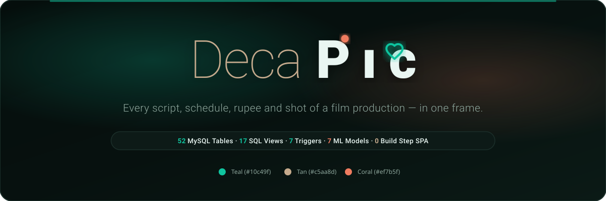
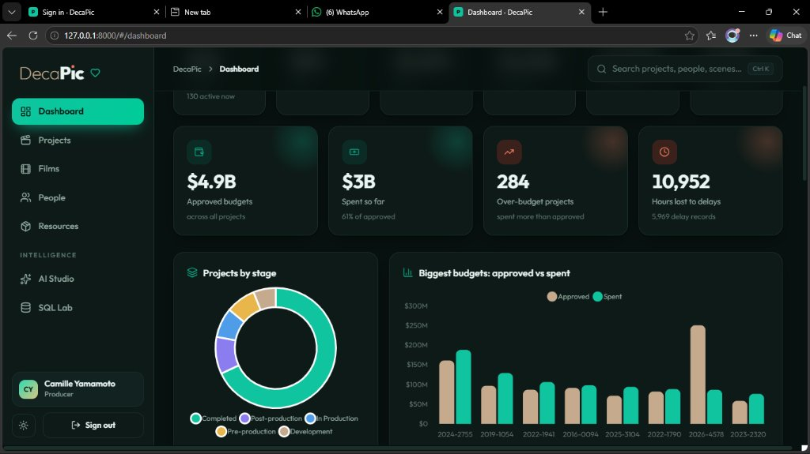
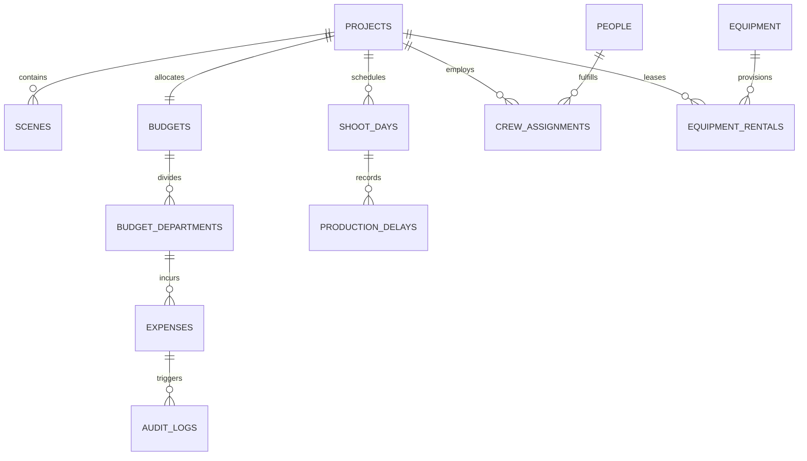

<div align="center">



<br/><br/>

[](https://fastapi.tiangolo.com)
[](https://mysql.com)
[](https://scikit-learn.org)
[](https://developer.mozilla.org)
[](https://chartjs.org)
[](#-brand-theme--design-tokens)
[](#architecture)

<br/>

### *“Every script, schedule, rupee and shot of a film production — in one frame.”*

A synchronized production management & predictive intelligence system powered by a **52-table MySQL database (`cineops`)**, **7 machine learning models**, dynamic triggers, stored procedures, and a responsive zero-build Vanilla JS SPA.

<br/>

[🎬 Live Showcase](#-live-ui-showcase) • [🎨 Brand Theme](#-brand-theme--design-tokens) • [✨ Key Features](#-key-features) • [🧠 AI Studio & ML](#-ai-studio--ml-layer) • [🔬 SQL Lab](#-sql-lab--database-architecture) • [🛡️ RBAC Personas](#️-role-based-access-control-rbac) • [🚀 Quick Start](#-quick-start)

</div>

---

## 🎬 Live UI Showcase

<div align="center">
  
  <p><em>Live DecaPic Production Control Room · Real-time aggregations across 52 MySQL tables with Chart.js analytics and quick role switching.</em></p>
</div>

---

## 🎨 Brand Theme & Design Tokens

DecaPic features a custom-crafted cinematic color palette designed for high legibility, contrast, and film production aesthetics:

| Token | Hex Code | Visual Swatch | Role & Usage |
| :--- | :--- | :--- | :--- |
| **Teal (Brand Primary)** | `#10c49f` | `████████` | Logo Heart `♡`, Primary Actions, Active Tabs, KPI Success |
| **Tan (Deca Accent)** | `#c5aa8d` | `████████` | Wordmark `"Deca"`, Secondary Stat Bars, Neutral Highlights |
| **Coral (Dot Accent)** | `#ef7b5f` | `████████` | Wordmark `i` dot `•`, Critical Alerts, Delay Highlights |
| **Dark Slate (Canvas)** | `#07110f` | `████████` | OLED Dark Mode background canvas |
| **Deep Forest (Card)** | `#0d1a17` | `████████` | Surface containers, card backgrounds, modal layers |
| **Border Line** | `#1b2f2a` | `████████` | Subtle borders, grid dividers, separators |
| **Warm Gold** | `#e8b64a` | `████████` | Pre-production stage, star ratings, medium severity |
| **Sky Blue** | `#4f9de8` | `████████` | In-Production stage badge, informational callouts |
| **Violet** | `#8b7cf0` | `████████` | Post-production stage badge, VFX scene tags |

### 🔍 Brand Wordmark Anatomy
* **`Deca`** — Typeset in ultra-light weight (`200`) in warm Tan (`#c5aa8d`).
* **`Pic`** — Typeset in heavy bold weight (`800`) in pure Mint/White (`#e9f6f2`).
* **`•` Dot** — The dot over the `ı` is an isolated glowing Coral circle (`#ef7b5f`).
* **`♡` Heart** — Pulsing teal outline heart (`#10c49f`) signifying the passion of filmmaking.

---

## ✨ Key Features

```
┌─────────────────────────────────────────────────────────────────────────────────────────┐
│                                   DECAPIC ECOSYSTEM                                     │
├──────────────────────────┬─────────────────────────────┬────────────────────────────────┤
│ 🎬 Production Control    │ 🧠 Predictive ML Engine     │ 🔬 SQL Lab & Data Engine       │
│ • Script & Scenes Breakdown│ • Scene Duration Predictor   │ • 52 Relational MySQL Tables   │
│ • Daily Shoot Call Sheets│ • Crew & Gear Demand Models │ • 17 Optimized SQL Views       │
│ • Real-time Budget Ledger│ • Delay Probability (AUC .89)│ • 7 Business Rule Triggers     │
│ • Incident & Delay Audit │ • Crew-Match Recommendation │ • Read-Only Console & Rollback │
└──────────────────────────┴─────────────────────────────┴────────────────────────────────┘
```

### 1. 🎛️ Live Operations Dashboard
* **Dynamic Role Adaptive View**: Adapts automatically based on role permissions (Executive financial charts for Producers; shoot schedules & genre distributions for Directors and Crew).
* **Live KPI Counters**: Real-time aggregation of projects, active films, scenes, shoot days, cast & crew members, and rental gear.
* **Audit Trail**: Real-time event log powered by automated database triggers capturing insertions, updates, and budget shifts.

### 2. 📽️ Project Control Center (9 Dedicated Tabs)
* **Overview**: Comprehensive film summary, synopsis, genres, budget status bar, and production houses.
* **Scenes**: Granular scene breakdown with filters for Interior/Exterior, Day/Night, VFX, and Stunt complexity.
* **Schedule**: Interactive shooting calendar, shoot-day call sheets, location assignments, and delay logs.
* **Cast & Crew**: Departmental roster, contract tracking, daily rates, and role assignments.
* **Budget**: Interactive department breakdown, stored procedure expense logger, and transaction-safe transfers.
* **Equipment**: Camera, lighting, grip, and sound gear inventory with automated rental tracking.
* **Issues & Delays**: Real-time delay log tracking hours lost by cause (weather, technical, cast availability).
* **Post & Release**: Post-production pipeline tasks, distributor deals, box office targets, and distribution rights.
* **AI Health**: Live shoot-day risk curve and interactive *"What-If"* budget/delay simulator.

### 3. 🧠 AI Studio & Machine Learning Suite
* **Scene Planner**: Interactive sliders to simulate scene duration, required crew count, and gear units.
* **Project Health Timeline**: Multi-variable risk forecast plotting predicted delay probability and cost curves.
* **Crew Match**: Recommends top-tier verified crew based on historical genre compatibility, skill level, and experience.
* **Model Lab**: Full transparency into training metrics, ROC curves, feature importance scores, and confusion matrix data.

### 4. 🔬 SQL Lab (The Database Playground)
* **Table Explorer**: Live schema inspector, row counter, column definitions, and foreign-key link visualizer.
* **Interactive Query Console**: Sandboxed read-only SQL editor with 28 pre-built production queries and execution timer.
* **Trigger Playground**: Test constraint triggers (Over-budget rejection, closed project locks, invalid payment caps) with **automatic rollback**.
* **ER Diagrams Gallery**: High-resolution schema diagrams mapping `budgets`, `people`, `scripts`, and `equipment`.

### 5. 🎨 Polished Frontend Experience
* **Zero Build Step**: Native ES6 Vanilla JS with reactive hash router — opens instantly with zero compilation.
* **100% Offline-Ready**: Bundled Chart.js, Outfit typography, and custom SVG icons.
* **Haptic Audio Feedback**: Synthesized Web Audio API mechanical sound effects on hover and click actions.
* **Global Command Palette**: `Ctrl + K` instant search across projects, films, crew members, and vendors.
* **Adaptive Theme**: One-click toggle between crisp Light and cinematic Dark OLED modes.

---

## 🧠 AI Studio & ML Layer

DecaPic features **7 specialized machine learning models** trained directly on the `cineops` database views.

| Model Name | Business Question Answered | Algorithm | Primary Metric | Baseline |
| :--- | :--- | :--- | :--- | :--- |
| **`scene_duration`** | How many hours will a scene take to shoot? | Gradient Boosting Regressor | **MAE: 0.85 hrs** (R²: 0.61) | MAE: 1.39 |
| **`crew_required`** | How many crew personnel are required for a scene? | Random Forest Regressor | **MAE: 4.54** (R²: 0.54) | MAE: 6.55 |
| **`equipment_required`** | How many gear units are needed for scene requirements?| Random Forest Regressor | **MAE: 4.82** (R²: 0.55) | MAE: 7.21 |
| **`equipment_units`** | How many camera/lighting/audio/grip units are needed?| Random Forest Regressor | **MAE: 1.33** (R²: 0.70) | MAE: 2.53 |
| **`production_risk_delay`**| Will this shoot day experience an operational delay? | HistGradientBoosting | **ROC-AUC: 0.89** (Acc: 81%) | Acc: 54% |
| **`crew_match`** | Is this candidate the optimal fit for the required role? | Random Forest Classifier | **ROC-AUC: 0.82** (Top-1: 83%) | Random: 50% |
| **`budget_overrun`** | By what percentage will the project exceed budget? | Ridge Regressor | **MAE: 0.107** | Baseline: 0.117 |

> [!NOTE]
> All ML models strictly respect **leakage prevention rules**: outcome columns (such as `delay_days` or `final_cost`) are never used as training features. Splitting is strictly performed at the **project level** (`ml_project_split`) so scenes of a single production never leak into both train and test sets.

---

## 🛡️ Role-Based Access Control (RBAC)

DecaPic includes a **Navbar Quick Account Switcher** enabling instantaneous 1-click role swapping.

| Role | Demo Email | Password | Access & Capabilities |
| :--- | :--- | :--- | :--- |
| 👑 **Producer** | `producer@decapic.com` | `Decapic@2026` | **Full Production Access**: Budgets, schedules, crew hires, AI Studio, SQL Lab. |
| ⚡ **Super Admin** | `admin@decapic.com` | `Decapic@2026` | **Root Privileges**: System configurations, audit logs, raw database operations. |
| 💰 **Finance Manager** | `finance@decapic.com` | `Decapic@2026` | **Financial Control**: Departmental allocations, expense logging, fund transfers. |
| 📋 **Production Manager** | `manager@decapic.com`| `Decapic@2026` | **Operations**: Shoot day tracking, vendor orders, logistics, call sheets. |
| 🎥 **Director** | `director@decapic.com` | `Decapic@2026` | **Creative Control**: Script breakdowns, scenes, cast roster, AI Scene Planner. |
| 👷 **Crew Member** | `crew@decapic.com` | `Decapic@2026` | **Operations View**: Call sheets, schedule, assigned scene requirements. |
| 🔍 **Authorised Reviewer** | `reviewer@decapic.com`| `Decapic@2026` | **Compliance**: Read-only oversight of budgets, contracts, and production milestones. |

---

## 🔬 SQL Lab & Database Architecture

The backbone of DecaPic is **`cineops`**, a 3NF normalized relational schema executing strict business rules at the database engine tier.



### 🛡️ Real-Time Business Triggers
1. **`trg_expense_budget_update`**: Automatically updates spent amounts in `budget_departments` when an expense is entered.
2. **`trg_check_budget_status`**: Blocks new expenses immediately if the project budget is in `Closed` status.
3. **`trg_shoot_day_wrap`**: Computes shooting delays and updates scene status when call sheets are wrapped.
4. **`trg_prevent_excessive_payment`**: Validates payment sums against contracted fee thresholds.
5. **`trg_audit_log_expenses`**: Immutably records every financial modification with timestamp and actor identity.

---

## 🚀 Quick Start

### Prerequisites
* **Python 3.10+**
* **MySQL 8.0.16+** (via Laragon, XAMPP, or standalone MySQL Server)

```bash
# 1. Clone repository & install dependencies
git clone https://github.com/your-username/decapic.git
cd decapic
pip install -r requirements.txt
```

### Database Initialization
> [!IMPORTANT]
> Ensure MySQL is running and `local_infile` is enabled in your MySQL session:
> ```sql
> SET GLOBAL local_infile = 1;
> ```

Run the automated database installer:
```powershell
# For Laragon default (empty root password):
python setup_database.py

# Or specify custom credentials:
python setup_database.py --user root --password YOUR_PASSWORD
```

### Train Machine Learning Models *(Optional but recommended)*
Train the 7 models on your local machine (~15 seconds):
```powershell
python ml/train_models.py
```

### Launch Application
```powershell
python run.py
```
DecaPic will automatically launch in your default browser at:
👉 **`http://127.0.0.1:8000`**

---

## 📁 Project Directory Structure

```text
decapic/
├── assets/
│   ├── banner.svg                # DecaPic official vector banner with logo theme
│   └── dashboard_preview.jpg     # High-resolution screenshot of live dashboard
├── backend/
│   ├── app/
│   │   ├── config.py             # Environment configurations
│   │   ├── db.py                 # PyMySQL connection pooling
│   │   ├── security.py           # JWT generation, Argon2 hashing & RBAC
│   │   ├── ml_service.py         # Joblib model loaders & prediction runners
│   │   ├── main.py               # FastAPI application entrypoint
│   │   └── routes/               # Modular REST endpoints
├── database/
│   ├── 01_schema.sql             # 52 tables with foreign keys and check constraints
│   ├── 02_load_data.sql          # Bulk CSV loading for synthetic film data
│   ├── 03_views.sql              # 17 analytical and ML training views
│   ├── 04_triggers_procedures.sql# Business triggers and stored procedures
│   ├── 05_security_roles.sql     # Database privilege schemas
│   ├── 06_sample_queries.sql     # 28 production queries used in SQL Lab
│   ├── 07_decapic_app.sql        # Application database users & demo accounts
│   └── data/*.csv                # High-fidelity synthetic dataset
├── frontend/
│   ├── index.html                # Single Page Application entrypoint
│   ├── css/app.css               # DecaPic Mint/Teal design system & keyframes
│   ├── js/                       # Modular Vanilla JS SPA files
│   └── vendor/                   # Offline bundled fonts & Chart.js
├── ml/
│   ├── train_models.py           # Model training pipeline
│   ├── README_ML.md              # Machine learning documentation & benchmark results
│   └── models/*.joblib           # Pre-trained ML model binaries
├── setup_database.py             # Database deployment automation script
└── run.py                        # Uvicorn FastAPI server launcher
```

---

## ⌨️ Keyboard Shortcuts & Productivity

| Shortcut | Action | Scope |
| :--- | :--- | :--- |
| <kbd>Ctrl</kbd> + <kbd>K</kbd> / <kbd>⌘</kbd> + <kbd>K</kbd> | Open Global Command Palette Search | Global |
| <kbd>Esc</kbd> | Close Modal, Drawer or Overlay | Global |
| <kbd>Hover</kbd> | Interactive Mechanical Sound Feedback | All Cards & Buttons |
| <kbd>Click</kbd> | Material Ripple Effect & Confirmation Sound | Interactive Controls |

---

<div align="center">

Made with ❤️ for cinema, data engineering & machine learning.

**DecaPic Control Room © 2026**

</div>
